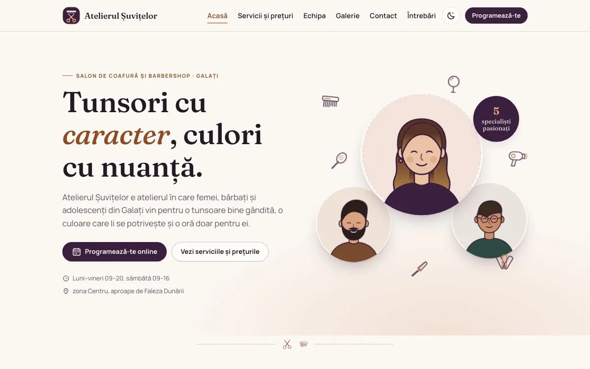

# Atelierul Șuvițelor — site de prezentare cu programare online

> **Proiect demonstrativ (portofoliu).** Salonul, adresa, telefonul, e-mailul, echipa,
> prețurile și programările existente sunt **fictive**. Programările făcute pe site se
> salvează doar în browserul vizitatorului (localStorage); nu ajung la nimeni.
> Textul de confidențialitate este un model generic și trebuie verificat de un jurist
> înainte de folosirea reală. Site-ul are `noindex`, ca să nu apară în motoarele de căutare.

**Live:** [manolacheioan.github.io/atelierul-suvitelor](https://manolacheioan.github.io/atelierul-suvitelor/)



## English summary

Portfolio project: a static website for a fictional hair salon and barbershop. Online booking shows only each specialist's free time slots (bookings are kept in the visitor's browser), plus a gallery and a light and dark theme. Next.js static export with no backend and no external requests, tested with Vitest, Playwright and axe (accessibility). The site itself is in Romanian.

Salon de coafură și barbershop din Galați, pentru femei, bărbați, adolescenți și copii.
Site static (Next.js 16, export în `out/`), fără backend, fără scripturi sau fonturi externe
și fără nicio cerere către alte servere în timpul rulării.

## Pornire rapidă

```bash
npm install
npm run dev            # http://localhost:3000
```

| Comandă                              | Ce face                                                         |
| ------------------------------------ | --------------------------------------------------------------- |
| `npm run lint`                       | ESLint                                                          |
| `npm run typecheck`                  | TypeScript, fără emitere                                        |
| `npm run clean && npm run build`     | build curat, rezultatul static în `out/`                        |
| `npm run test:unit`                  | Vitest: disponibilitate, validări, adaptorul de stocare         |
| `npm run test:e2e`                   | Playwright + axe pe build-ul din `out/` (rulează build-ul întâi) |
| `npm test`                           | ambele seturi de teste                                          |
| `npm run serve`                      | servește `out/` local (port 4174), cu compresie                 |

Testele Playwright au nevoie de browsere: `npx playwright install chromium` (o singură dată).

## Structură

```
app/                    paginile (Acasă, servicii, echipa, galerie, programare, contact, întrebări, confidențialitate, 404)
  globals.css           tot stilul: culori, teme (luminoasă / întunecată), animații
  fonts/                fonturile găzduite local (Fraunces + Manrope, licență OFL)
config/site.ts          NUMELE afacerii, contact, program, pauză de prânz, sărbători, meniu
data/services.ts        servicii, durate, prețuri, categorii
data/staff.ts           echipa: specialități, servicii, zile de lucru, portret / fotografie
data/gallery.ts         galeria de stiluri
data/faq.ts             întrebări frecvente
lib/availability.ts     calculul orelor libere (modul pur, testat)
lib/demo-bookings.ts    programări „existente” generate pentru demo
lib/validation.ts       validarea numelui și a telefonului românesc
lib/booking/            adaptorul de stocare a programărilor (vezi „Backend real”)
components/             antet, subsol, calendar, flux de programare, ilustrații, iconițe
tests/                  teste Playwright și axe
scripts/serve.mjs       server static minimal pentru teste și Lighthouse
```

## Editarea conținutului

Totul e în fișiere TypeScript tipizate; editorul îți arată imediat dacă lipsește un câmp.

- **Prețuri, durate, servicii noi:** `data/services.ts`. Fiecare serviciu are `id`, `name`,
  `category` (`femei` / `barbati` / `copii`), `group` (rândul de grup din tabel),
  `durationMin`, `priceLei` și, opțional, `priceFrom: true` pentru „de la …”.
  Totalurile din programare se calculează automat.
- **Echipa:** `data/staff.ts`. `serviceIds` spune ce servicii face fiecare (pagina Echipa,
  tabelul „cine ce face” și filtrarea din programare folosesc aceeași listă).
  `workDays` folosește 0 = duminică … 6 = sâmbătă.
- **Program, pauză, sărbători:** `config/site.ts` → `schedule`. Poți schimba orele pe zile,
  pauza de prânz, pauza dintre clienți (`bufferMin`), pasul orelor (`slotStepMin`),
  avansul minim (`minLeadMin`), câte zile în avans (`horizonDays`) și lista `holidays`.
- **Contact:** `config/site.ts` → `site` (telefon afișat și format `tel:`, adresă, zonă, e-mail).
- **Întrebări frecvente:** `data/faq.ts` (`{phone}` se înlocuiește cu telefonul din config).

Un test unitar verifică automat că fiecare serviciu are cel puțin un specialist și că
specialiștii fac doar servicii care există.

## Redenumirea afacerii

Numele apare într-un singur loc: `BUSINESS_NAME` din `config/site.ts`. Titlurile paginilor,
logo-ul, subsolul, textele și testele îl preiau de acolo. Actualizează apoi și e-mailul și
conturile sociale din același fișier, iar textul din acest README.

## Înlocuirea ilustrațiilor cu fotografii

- **Echipa:** pune poza în `public/echipa/` (ex. `ioana.webp`, pătrată, ~400×400) și adaugă
  `photo: "/echipa/ioana.webp"` la persoana respectivă în `data/staff.ts`.
- **Galerie:** pune poza în `public/galerie/` și completează `image: "/galerie/nume.webp"` în
  `data/gallery.ts`. Câmpul `alt` e deja scris pentru fiecare lucrare; verifică-l să descrie
  poza reală.
- Dacă `photo` / `image` lipsește, se afișează automat ilustrația SVG (`portrait`).
- Folosește doar fotografii pentru care ai drepturi și acordul persoanelor din ele.

Iconițele și ilustrațiile sunt componente SVG originale în `components/icons.tsx` și
`components/illustrations/`.

## Programarea online

1. **Servicii** — se pot alege mai multe; durata și prețul se adună.
2. **Specialist** — doar cei care fac toate serviciile alese, sau „oricine e liber”
   (se atribuie automat cel mai puțin încărcat în ziua aleasă).
3. **Data și ora** — următoarele 30 de zile; zilele închise, sărbătorile și zilele fără
   locuri sunt dezactivate. Calendarul e făcut de la zero, cu tastatură completă
   (săgeți, Home/End, PageUp/PageDown, Enter).
4. **Datele tale** — nume și telefon românesc (07…, 02…, 03…, cu sau fără +40/0040,
   spații, puncte, cratime), acord pentru prelucrare.

Ecranul de confirmare spune sincer că programarea e salvată pe dispozitiv și că nu se
trimite SMS. Programarea se poate anula imediat sau, mai târziu, din lista „Programările
tale” de pe pagina de programare.

Orele libere țin cont de programul zilei, durata totală, programările existente,
pauza dintre clienți, pauza de prânz, avansul minim și sărbători. Calculul lucrează cu
„ora de pe ceasul salonului” (fus orar `Europe/Bucharest`), deci schimbarea orei de
vară/iarnă nu mută sloturile — situație acoperită de teste.

## Backend real

Interfața nu vorbește direct cu localStorage, ci cu un **adaptor** (`lib/booking/types.ts`):

```ts
interface BookingAdapter {
  kind: "local" | "remote";
  listTaken(from, to): Promise<ExistingBooking[]>; // intervale ocupate (ale tuturor)
  listMine(): Promise<StoredBooking[]>;              // programările de pe acest dispozitiv
  create(request): Promise<StoredBooking>;           // aruncă SlotTakenError dacă ora e ocupată
  cancel(id): Promise<void>;
}
```

Adaptorul folosit se alege într-un singur loc: `getBookingAdapter()` din
`lib/booking/index.ts`.

**Variante:**

- **API propriu (recomandat).** `lib/booking/http-adapter.ts` e un exemplu complet care
  așteaptă `GET /taken`, `POST /bookings` (409 dacă ora e ocupată) și `DELETE /bookings/{id}`.
  Serverul trebuie să verifice din nou disponibilitatea — poate refolosi chiar
  `lib/availability.ts`, care nu depinde de browser. Schimbă în `index.ts`:
  `createLocalStorageAdapter(...)` → `createHttpAdapter("https://api.exemplu.ro", safeLocalStorage())`.
- **Formspree sau e-mail.** Scrie un adaptor al cărui `create` trimite un `POST` JSON la
  formularul tău (ex. `https://formspree.io/f/<id>`). Atenție: un astfel de serviciu doar
  livrează e-mailul, nu știe ce ore sunt ocupate, deci programarea devine o *cerere* pe care
  salonul o confirmă telefonic — schimbă textele din ecranul de confirmare în consecință.
- După conectare, nu mai folosi `lib/demo-bookings.ts` (programările demo) și actualizează
  politica de confidențialitate (unde ajung datele, cât timp sunt păstrate).

Adresele de API se pun în fișierele de mediu ale găzduirii (ex. `NEXT_PUBLIC_…`), nu în cod.

## Identitate vizuală

- Paletă: vânătă `#3B1F3F`, cupru `#C8794B`, roz pudrat `#F4E3DC`, ivoriu `#FBF7F2`,
  text `#241A26`. Cuprul pur e doar decorativ; textul colorat folosește `#8E4A23`
  (contrast 6,2:1 pe ivoriu). Tema întunecată e opțională (butonul cu lună) și se ține minte.
- Fonturi: Fraunces (titluri, serif expresiv) și Manrope (text), găzduite local, cu fișiere
  separate pentru diacriticele românești.
- Animații: foarfeca din hero „taie” titlul, unelte plutitoare cu parallax la derulare,
  apariții la derulare, efecte pe carduri, studio de culoare înainte/după, tranziții între
  pagini, 404 animat. Toate se opresc cu „reducere mișcare” din sistem.

## Calitate

- Vitest: disponibilitate (suprapuneri, durate, pauză între clienți, prânz, zile închise,
  sărbători, marginea zilei, avans minim, schimbarea orei), validări, adaptorul localStorage.
- Playwright (telefon + desktop): flux complet de programare, „oricine”, ora ocupată dispare,
  anulare, validări, calendar și ore doar din tastatură, meniu, temă, galerie, mișcare redusă,
  CLS, **nicio cerere externă**.
- axe (WCAG 2.2 AA) pe toate paginile, în ambele teme, și pe fiecare pas al programării.
